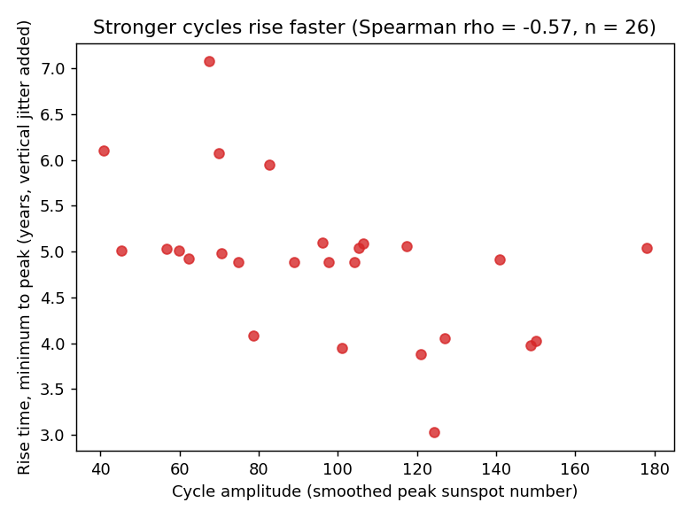
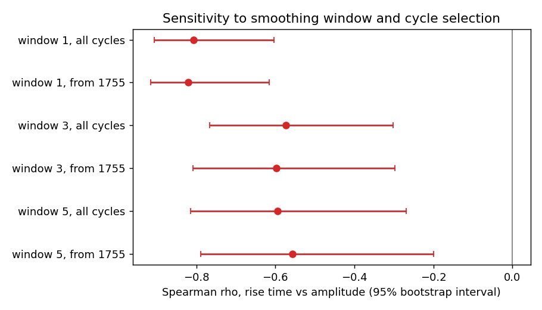

# Sunspot cycles: do stronger ones rise faster?

Solar activity comes in roughly 11-year cycles of very uneven strength. This
repository asks one narrow question of the 1700-2008 yearly sunspot record that
ships with statsmodels: **across cycles, is a stronger cycle also one that
climbs to its peak more quickly?** (Astronomers call this the Waldmeier effect.
It is an established result, so this is a small, careful re-check on a
bundled dataset, not a discovery.)

## Headline finding

**Yes, moderately.** Across 26 complete cycles, the stronger the cycle, the
shorter its rise from minimum to peak: Spearman rho = **-0.57** (permutation
p = 0.0024, 95% bootstrap interval -0.77 to -0.30).

| Cycle length measured against amplitude | rho | permutation p | 95% bootstrap interval |
| --- | --- | --- | --- |
| Rise time (minimum to peak) | **-0.574** | 0.0024 | -0.766 to -0.303 |
| Fall time (peak to next minimum) | +0.165 | 0.4245 | -0.199 to +0.506 |
| Total cycle length | -0.274 | 0.1780 | -0.636 to +0.143 |

Two supporting facts. Rises are shorter than falls: mean 4.88 vs 6.04 years,
and shorter in 18 of 26 cycles. And the effect is carried by the rise, not the
fall: fall time shows no detectable relationship with strength.



The scatter is noisy. A correlation of -0.57 means strength explains a
meaningful share of rise-time ranking, not that you can predict one from the
other. Dropping any single cycle leaves rho between -0.63 and -0.53.

## How much to trust it

The size of the effect depends on an analysis choice. The cycle detector locates
minima and peaks on a smoothed series; the table shows rho for three smoothing
windows, with and without the pre-1755 cycles (before the conventional numbering
begins, when observations were sparser).

| Specification | n | rho | 95% bootstrap interval |
| --- | --- | --- | --- |
| window 1 (no smoothing), all cycles | 26 | -0.807 | -0.907 to -0.603 |
| window 1, from 1755 | 22 | -0.821 | -0.915 to -0.615 |
| **window 3, all cycles (primary)** | 26 | **-0.574** | -0.766 to -0.303 |
| window 3, from 1755 | 22 | -0.597 | -0.809 to -0.297 |
| window 5, all cycles | 26 | -0.594 | -0.814 to -0.269 |
| window 5, from 1755 | 22 | -0.557 | -0.789 to -0.200 |

The sign and significance are stable everywhere; the magnitude ranges from
about -0.56 to -0.82. Window 3 was my primary specification, fixed before I ran
the other windows. Unsmoothed data gives a clearly stronger effect, so window 3
is not the most flattering choice. Quote the range, not one number.



## Limitations

- **Coarse timing.** Data are annual, so rise time takes only five values
  (3 to 7 years) and each is uncertain by about a year. This blurs the
  relationship; it does not create one.
- **Cycles are not independent.** Neighbouring cycle strengths are related
  (there is a slower ~80-100 year modulation). The permutation test treats
  cycles as exchangeable, so the p-values are somewhat optimistic. The bootstrap
  intervals share that flaw.
- **Three outcomes were tested.** Rise time is the one I specified in advance;
  fall time and total length are descriptive extras. No multiple-comparison
  correction is applied.
- **Old sunspot-number version.** The statsmodels table is the pre-2015 series
  from NOAA/NGDC. The community recalibrated the record in 2015, and the numbers
  differ, so absolute amplitudes here do not match current published values.
- **Description, not mechanism.** Nothing here explains why the relationship
  exists. There are also only 26 cycles.
- **Partial cycles dropped.** The record starts mid-cycle in 1700 and ends in
  2008 before the next minimum, so analysis spans 1712-1996.

Detected cycle minima were checked against the published cycle-start dates
(Wikipedia's "List of solar cycles", derived from SILSO): all 22 comparable
minima fall within 2 years (`tests/test_cycles.py`).

## Setup and running

```bash
python3 -m venv .venv
.venv/bin/python -m pip install -r requirements.txt
.venv/bin/python -m pytest -q          # tests (about 20 s)
.venv/bin/python analysis.py           # ~25 s; writes outputs/
```

`analysis.py` prints every number quoted above and writes `outputs/cycles.csv`,
`outputs/results.json` and three PNG figures. Everything is seeded, so reruns
produce identical numbers. No network access or API key is needed.

## Repository layout

```
analysis.py                 command-line entry point
src/sunspot_cycles/
  data.py                   load + validate the bundled series
  cycles.py                 smoothing, minimum detection, per-cycle measures
  stats.py                  Spearman, permutation test, bootstrap, leave-one-out
  figures.py                the three figures
  report.py                 orchestration and text summary
tests/                      unit tests, real-data checks, pinned README numbers, smoke test
scripts/push.sh             verify-then-push helper
DESIGN_NOTES.md             decisions, tradeoffs, what I would do next
```

## Data

Yearly sunspot numbers 1700-2008, from the National Geophysical Data Center
(NOAA), distributed in `statsmodels.datasets.sunspots` and marked public
domain there.

## License

MIT. See `LICENSE`.
